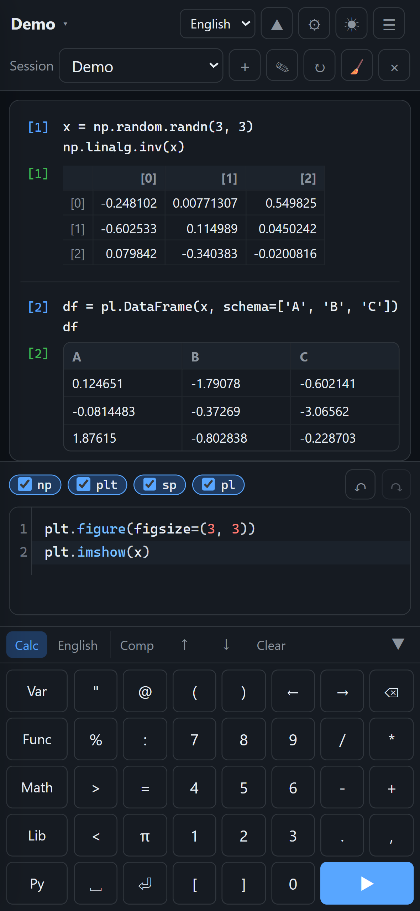

# PyCalc

[中文](README.md) | **[English](README.en.md)** | [日本語](README.ja.md)



https://ruoyu0088.github.io/pycalc

PyCalc is a **single-file offline Python calculator generator**. The build script inlines the Pyodide runtime and the selected scientific computing libraries into one HTML file; that HTML can be opened by double-clicking or via `file://`, it makes no network requests, and it offers Jupyter/IPython-style input and output, multiple named sessions, and history and variables that survive a refresh.

```
pycalc-app/
├─ start.bat        ← double-click to launch the Tkinter builder
├─ gui.py           ← builder GUI
├─ build.py         ← command-line entry point
├─ .github/workflows/deploy.yml ← automatic GitHub Pages build/deploy
├─ pycalc_build/    ← build pipeline
├─ frontend/        ← CodeMirror sources (build output is committed; building the HTML needs no Node)
├─ tests/           ← unit tests and browser acceptance tests
├─ cache/           ← runtime/wheel cache (gitignore)
└─ dist/            ← output HTML (gitignore)
```

Reference material (`console.html`, `inline_wasm_b64.py`, `test_indexeddb.html`) lives in `../reference/`, outside the repository, and is not tracked by git.

---

## Quick Start

1. Double-click `start.bat` to open the builder.
2. In the **Libraries** text editor, define the packages and aliases you want inlined (numpy / matplotlib / sympy by default), choose the output path, then click **Build** or **Build and open**.
3. When generation finishes, double-click the HTML (or click **Open output file**).

The first build needs a network connection to download the Pyodide runtime and the wheels; afterwards `cache/` is reused, and you can tick **Use cache only (offline)**.

### Command line

```bat
:: Default: Pyodide 314.0.7, everything inlined
python build.py --libs numpy sympy matplotlib --output dist\pycalc.html

:: Pin an older LTS runtime
python build.py --libs numpy sympy --pyodide-version 0.27.8 --output dist\pycalc-0278.html

:: Standard library only (smallest size)
python build.py --libs --output dist\pycalc-min.html

:: Only prepare the cache, do not generate HTML
python build.py --libs numpy sympy matplotlib --fetch-only

:: List every installable package in the lock of a given version
python build.py --list-libs --pyodide-version 314.0.7

:: Build log language (zh / en / ja)
python build.py --libs numpy --lang ja --output dist\pycalc-ja.html

:: Custom auto-import aliases (repeatable; the np:numpy form also works)
python build.py --libs numpy sympy --alias np=numpy --alias sp=sympy --output dist\pycalc.html

:: Inline packages only, without auto-import / without library checkboxes
python build.py --libs numpy --no-default-aliases --output dist\plain.html
```

When the build finishes it prints the **exact byte size** of the final HTML, the Python version, the dependency closure and the elapsed time. Add `--json` for machine-readable results (logs go to stderr).

---

## Library Definitions and Aliases

The **Libraries** text editor in the Tk builder directly determines which packages are embedded in the HTML and which auto-import checkboxes appear at the top of the HTML. Default content:

```text
# Packages embedded into the HTML (comma or whitespace separated).
numpy, matplotlib, sympy

# alias = import module (a colon also works)
np = numpy
plt = matplotlib.pyplot
sp = sympy
```

Rules:

- Lines without `=` / `:` are a **package list**, separated by commas or whitespace; you can use several lines.
- Lines containing `=` or `:` are **alias definitions**: `alias = imported module`. For example `pd = pandas`, `np:numpy`.
- Blank lines and `#` / `;` comments are ignored; optional `[packages]` / `[aliases]` sections are also supported for readability.
- An alias must be a valid Python identifier; the same alias or the same module cannot be defined twice.
- Which module a package maps to is inferred from the `imports` metadata of the Pyodide lock, so submodules and differently named modules such as `plt = matplotlib.pyplot` and `sk = sklearn` (package scikit-learn) both resolve.
- If the module an alias points to is not provided by the selected packages, the build fails with an explicit error telling you which package provides that module.
- **One alias corresponds to one HTML checkbox.** If you list only a package without an alias, the package is still inlined, but no auto-import checkbox is created.
- Checkbox behaviour: ticking `np = numpy` makes the HTML run `import numpy as np` automatically; ticking `plt = matplotlib.pyplot` automatically runs `import matplotlib.pyplot as plt`; the same applies to `pd = pandas`.

User example (including pandas):

```text
numpy, matplotlib, sympy, pandas

np = numpy
plt = matplotlib.pyplot
sp = sympy
pd = pandas
```

All GUI settings (including this library definition) are stored in `gui_settings.json` and restored automatically the next time you start. Configurations from older versions that only saved a `libs` list are migrated automatically to the new text format.

### Remote CSV / HTTP

Every build automatically embeds `pyodide-http` as a **non-selectable mandatory package** and runs `pyodide_http.patch_all()` during Python startup. Polars can therefore read URL sources through the browser:

```python
import polars as pl
df = pl.read_csv("https://example.com/data.csv")
```

Limits:

- The remote server must send CORS headers such as `Access-Control-Allow-Origin: *`; this does not bypass the browser same-origin policy.
- The whole response is downloaded into memory before Polars parses it, so very large CSVs need a lot of memory.
- The patch targets Python `urllib`/`requests`; in the current Pyodide build Polars reads URLs through `urllib.request.urlopen`, so it applies.

---

## Automatic GitHub Pages Deployment

The repository already contains [`.github/workflows/deploy.yml`](.github/workflows/deploy.yml). **The repository root should be `pycalc-app/`, the directory containing `build.py`** (do not use the parent directory with its `reference/` and `agent.md` as the repository root). Once you push the project to GitHub it builds and publishes automatically:

1. Push to the default branch `main` or `master` (you can also run `Build and deploy PyCalc` manually on the Actions page).
2. One-time setup: open the repository's **Settings → Pages → Build and deployment** and set **Source** to **GitHub Actions**. GitHub's API allows enabling Pages automatically with a PAT, but the default `GITHUB_TOKEN` cannot do the "first enable", so one manual click is needed here; after that, every push publishes fully automatically. If you want the first run to be click-free as well, create a PAT with Pages write permission, save it as `PAGES_TOKEN`, and add `token: ${{ secrets.PAGES_TOKEN }}` and `enablement: true` to the `configure-pages` step.
3. The workflow will:
   - run the unit tests (Tk tests are skipped automatically when there is no display);
   - download or reuse the cached Pyodide runtime and wheels;
   - build the full HTML;
   - output `_site/index.html`;
   - publish through `actions/deploy-pages`.
4. When publishing is done, the `deploy` job in Actions reports the URL in the form:

   `https://<username>.github.io/<repository>/`

The default build configuration lives in `env` at the top of the workflow:

```yaml
env:
  PYCALC_VERSION: "314.0.7"
  PYCALC_LIBS: "numpy sympy matplotlib"
```

Change it here to switch the inlined libraries or the Pyodide version. The CLI's standard aliases (`np` / `plt` / `sp` / `pd`) are used by default; if the Pages build also needs custom aliases, append `--alias` arguments to the `python build.py` command in the workflow (the Tk `gui_settings.json` is used on your machine only and is not synced to Actions). The first run has to download the runtime and wheels from the CDN; afterwards `cache/` is reused. The HTML is about 34 MB, within the size limits of GitHub Pages.

Note: a Pages site is a separate `https://` origin, so its IndexedDB sessions are **not shared** with an HTML opened locally via `file://`; this is dictated by the browser's same-origin policy.

---

## PWA / Installing on a Phone

The build generates 4 accompanying PWA files next to the HTML:

```text
dist/
├─ pycalc.html
├─ manifest.json
├─ sw.js
├─ icon-192.png
└─ icon-512.png
```

`pycalc.html` itself is still a fully self-contained single file; the PWA files are just extra sibling files used for installation and offline caching. The Service Worker only caches the entry HTML, the manifest and the icons—runtimes such as Pyodide/NumPy/Matplotlib and the inline Worker all live inside the HTML and need no extra caching.

`manifest.json` uses a light launch background `#f6f7f9` and a dark `theme_color: #20252e`: the manifest is static and cannot follow the system theme; the light background matches the default light UI, and the dark theme colour matches the top bar/status bar. For a dark splash screen, change both to `#0d1117`.

### Verifying on desktop

1. In `dist/`, run `python -m http.server 8000` and open `http://localhost:8000/pycalc.html`.
2. Chrome/Edge DevTools → **Application → Service Workers**: confirm that `sw.js` is **activated**.
3. **Application → Cache Storage** should show `pycalc-<html-hash>` containing the entry page, `manifest.json` and the two icons.
4. Tick **Offline** in the **Network** panel and refresh: the page should load completely and be able to run `1+1`.

`http://localhost` / `127.0.0.1` are treated as secure contexts by browsers, so Service Workers are allowed locally too; other plain `http://` pages and `file://` pages never register one.

### Android Chrome

Open the site over HTTPS, for example:

```text
https://ruoyu0088.github.io/pycalc/
```

Menu → **Add to Home screen**; when opened from the home-screen icon it should be standalone (no address bar). After the first online visit the Service Worker caches the entry; you can still open and run it with no network.

### iOS Safari

- `file://` does not support IndexedDB, so sessions cannot be saved.
- After opening over `https://` you can "Add to Home screen", and Service Worker offline caching is supported.
- iOS ITP may clear site storage after long periods without visits, so IndexedDB/caches may be lost; this is a system limitation that cannot be worked around in the frontend.

### Updates and limitations

- The cache version in `sw.js` comes from the first 8 characters of the SHA256 of the final HTML; when the **HTML content changes** the cache name changes, and users pull the new version the next time they open it.
- Rebuilding identical content does not change `sw.js`; this avoids making users re-download the whole HTML on every deployment.
- An update usually needs two refreshes: the first fetches the new Service Worker, the second serves the page from the new cache.
- `skipWaiting()` + `clients.claim()` are enabled, but there is no extra "update available" UI.
- Under `file://` the browser ignores the manifest and SW registration is skipped by the protocol check; the core HTML functionality is unaffected, it just cannot be installed or used offline.
- `manifest.json`'s `start_url` is fixed to `"./"` (on Pages that is `index.html`). When you run the local HTTP acceptance test with `pycalc.html`, the SW caches `pycalc.html` separately and offline refresh works; but a locally "installed" app's start page points at the directory, so use the Pages `https://.../pycalc/` URL for real installation / home-screen testing.
- Both the Service Worker cache and IndexedDB may be cleared by the browser under storage pressure. After a successful registration it silently requests `navigator.storage.persist()` to improve the odds of retention, but this cannot guarantee permanent retention on iOS or when storage is cleared.
- The current Pages build includes pandas/polars and the HTML is about **64 MB**; the first install/offline cache is heavier than the base version.
- Local `file://` and Pages `https://` are different origins, and sessions are not shared between them.

---

## Interface Features

- **Trilingual UI**: Chinese / English / Japanese. The HTML switches in the top bar; the Tk builder switches in the top-right corner. The language preference is remembered, and the first launch follows the browser/system language.
- **One continuous output block**: no more separate card per input/output, and no "success / time" title bar. Inputs and outputs are laid out one after another in a single scrollable panel.
- **Numbers are insert handles**: only numbers such as `[1]`, `[2]` are shown before inputs and outputs; clicking a number inserts the corresponding code or output text at the current editor cursor without clearing the input box. Outputs that contain only an image and no text report that there is no text to insert.
- **`ans` keeps the last valid result**: after each run, if the result of the last expression is not `None`, that object is stored in `ans`. `print(...)`, plain assignments, explicit `None` and exceptions never overwrite the previous `ans`; `ans` appears in the variables table and is saved/restored with the session snapshot.
- **The input box is cleared after a run**; `↑` / `↓` switch between historical inputs and restore the unsubmitted draft when you return to the newest entry.
- **Resizable sidebar**: drag the divider between the sidebar and the main area; the width is remembered. On narrow screens the sidebar becomes a drawer and the divider is hidden automatically.
- **IPython-style attribute completion**: typing `x.`, `np.`, `np.linalg.` lists the members/methods/module functions of that object, with signatures for function entries; typing a prefix such as `arr.re` keeps filtering. Completion prefers the real type of **already executed objects** in the current session; if the variable has not been run yet, it also does static inference from assignments/type annotations in the editor, so after `arr = np.linspace(1, 2)` typing `arr.` still recognises it as `numpy.ndarray`, with `arr : numpy.ndarray` shown at the bottom. Private members are hidden by default and expand after you type `_`. Top-level variable/function names can still be completed; keywords such as `if` / `for` are no longer completed.
- **Display settings**: the gear button in the top bar opens a dialog for SymPy expressions (text / math / all math), NumPy output (default / pretty / table), float precision (auto or 6/8/10/12/15 significant digits), DataFrame output (text / table), and "hide the final expression when a figure is produced". NumPy tables support 1-D arrays as a single row without row/column headers (falling back to Pretty above the column limit), small 2-D arrays, and tabbed 3-D arrays, with limits on tabs/rows/columns; DataFrames can limit rows and columns, with `…` replacing omitted middle columns. The DataFrame row count only affects tables created afterwards; the other settings redraw existing history immediately. Float results carry a numeric tree so history can switch precision back and forth; numeric DataFrame and NumPy table cells use the same precision. Older history lacking numeric/table/container-math data falls back to text.
- **History undo/redo**: Undo / Redo on the right of the library bar only removes or restores the last history entry, without changing the current Python variables, `ans` or functions. Handy for clearing a mistyped entry from the history; numbering is reused.
- **Function call hints**: inside `f(`, `np.linspace(`, `arr.reshape(` the signature is shown near the cursor; `Ctrl+Space` triggers completion manually.
- **Automatic bracket/quote pairing**: typing `(`, `[`, `{`, `'`, `"` inserts the closing character; with text selected, typing a bracket/quote wraps the selection.
- **High-contrast selection**: the editor selection has a clearly visible background in both light and dark themes, no longer blending in with normal text.
- Attribute completion prefers the live namespace; assignments that have not been run yet get static inference for common numpy/sympy/matplotlib constructors and type annotations, and for other complex expressions it is still best to run the code first and then complete.
- **Selectable run key**: `Ctrl/Cmd+Enter` or `Enter`. With `Enter`, code runs only when Python considers it "complete" (`def`/`if`/unclosed brackets, syntax errors etc. keep inserting newlines); `Shift+Enter` always inserts a newline; IME composition never triggers it by accident.
- **Leaner on touch devices**: when `pointer: coarse` matches and the virtual keyboard was created successfully, the run-key selector, the run button and the bottom hint bar are hidden; the run entry point moves to the keyboard's `=` key. Desktop mode is completely unchanged.
- **Startup order**: the editor and history appear first, and a fixed floating overlay in the top-right corner shows `Loading Python… / Installing libraries… / Initializing… / Restoring session…` without taking up top-bar layout; running, session switching and library checkboxes are disabled until the runtime is ready. Python starts and runs in a Web Worker, so the main thread can still accept typing and scroll the history while loading; Matplotlib is loaded only when `plt` is ticked or the code actually does `import`, so ordinary calculations no longer trigger `matplotlib.pyplot`.
- **Light/dark theme**: CSS, CodeMirror syntax highlighting and the default Matplotlib style all switch together. The first launch follows the system `prefers-color-scheme`, and the choice is remembered afterwards. Matplotlib only affects figures generated after the theme switch; historical PNGs are not redrawn.
- **Extension library checkboxes**: above the input box, every alias from the **build-time library definition** is listed, for example `numpy (np)`, `matplotlib.pyplot (plt)`, `sympy (sp)`, `pandas (pd)`. Ticking one imports it automatically, with no need to write `import`. A new session loads only Math by default; extension libraries must be ticked; the selection state is saved in the session and restored when switching sessions.
- **Math is always loaded**: names such as `sin, cos, tan, sqrt, exp, log, log10, factorial, pi, e, inf, nan` are available directly, like on an ordinary calculator; Math does not appear in the extension library list and is not written to the variables table. `range` has moved to the function drawer.
- **Function drawer**: `drawers.functions.items` in `keyboard_layout.py` lets you hand-maintain the built-in functions (currently `print, range, enumerate, len, int, float, str, list, dict, set, tuple, sum, min, max, sorted, zip, map, filter`); these fixed entries come first, and functions the user defines in a session are appended after them automatically.
- **Variable drawer**: `drawers.variables.items` places `x, y, z, a, b, c, i, j, k` there by default, ahead of user variables; a user variable with the same name is not shown twice.
- **Two tables in the left sidebar**: the current session's user variables (name / type / value) and user functions (name / parameters). `DataFrame` values from pandas / polars show only `shape` and the first 8 column names, not the full table. They refresh after every run, session switch and library change; automatically imported names and functions do not appear in the tables.

---

## Phone Virtual Keyboard

On `pointer: coarse` devices a screen keyboard is created at the bottom of `#app` as part of the flex layout (not a fixed overlay). Desktop browsers create no keyboard DOM, and `inputmode` is not modified.

### Two input tabs + a clear button

- **Calc**: 5 vertical buttons on the left (variables / functions / math / libraries / Python) and a 6×5 number/symbol keypad on the right; digit keys, `π`, brackets, space, newline and the run key are all here.
- **English**: 5 rows in letter mode, `⇧` capitalises only the next letter; `123` switches to number mode and `ABC` switches back. Number mode includes symbols and `Space / ← / → / Enter`.
- **Compact tab row**: the Calc / English / Complete / Clear / Collapse buttons use tighter spacing and padding; the `[1]` button shows or hides the `[n]` execution numbers in history; when hidden, input uses a thin blue rule and output a thin green rule so they stay distinguishable while using the full width; the preference is saved globally.
- **Cursor arrows**: `↑` / `↓` in the tab row move the cursor up/down in normal positions; on the first/last line they switch to the previous/next history entry instead, matching the physical ArrowUp/ArrowDown keys.
- **Clear**: sits after the English tab and only clears the editor content, without changing the current tab, the history or the variables.
- **Collapse/expand**: the `⌄` / `⌃` at the far right of the tab row controls whether the keyboard panel is shown; when collapsed only the tab row remains and the history area grows automatically. Clicking it again, or clicking the Calc/English tab, slides the keyboard out.
- **Auto-indent on Enter**: `⏎` uses CodeMirror's `insertNewlineAndIndent`, so after `for i in range(10):` Enter moves to the next line indented by 4 spaces.
- **Collapse the Session bar**: a new `⌃` / `⌄` button in the phone top bar hides/shows the session bar; the history area grows when it is hidden, and the preference is saved.

Clicking the 4 buttons at the top left slides a drawer down **from the top of the screen**; variables/functions/libraries are read live at the moment they open, so a new `f` or variable added by a run is visible immediately. Function entries get `(` appended automatically.

### Library quick-input tab

The library drawer shows only the tabs of **currently ticked** extension libraries, labelled with the alias (`np`, `plt`, `pd`, `pl`, `sp`, `la`), in the order they were ticked; when nothing is ticked it shows "tick an extension library first". Each tab's buttons come from `library_quick` in `keyboard_layout.py`; buttons **show only the English name, without `(`**, and the bracket is inserted on click.

```text
?arange(    library member
?.sum(      member that both libraries and objects have
.tolist(    member that only objects have
.shape      object attribute (no brackets)
np          inserted directly
```

- `?arange(`: `np|` → `np.arange(`; `np.|` → `np.arange(`; at line start/after an operator → `np.arange(`; anywhere else it inserts `np.arange(` directly.
- `?.sum(`: `np|` / `np.|` → `np.sum(`; `x|` / `x.|` / `x.y|` / `)` / `]` → `x.sum(`; at line start/after an operator → `np.sum(`.
- `.tolist(` / `.group_by(`: inserted only in an object context; after `np|`, `pl|`, at line start or after an operator it prompts "enter an object first" and never produces `np.tolist` or `pl.group_by`.
- `.dtype`, `.shape`, `.T` act only as object attributes; `loc` / `iloc` use `.loc[` / `.iloc[`, displayed without the `[`.
- A selected library with no quick buttons shows "no quick buttons for this library yet" and its tab is not hidden.

### Single source of truth for the layout

Keys, tabs, views and drawers are all defined in:

```text
pycalc_build/keyboard_layout.py -> LAYOUT
```

At build time this is inlined as `CFG.keyboard` through `page_config["keyboard"]`; `keyboard.js` contains no hard-coded math functions, keywords or key lists. Just rebuild after changing `LAYOUT`. `keyboard.css` / `keyboard.js` are inlined into the single-file HTML as well.

### System keyboard

- The editor `contentDOM` sets `inputmode="none"`, `autocorrect=off`, `autocapitalize=none`, `spellcheck=false`, `virtualkeyboardpolicy=manual`; every keyboard button calls `preventDefault` on `pointerdown`, so focus is never handed to the button.
- **Android Chrome**: with `inputmode=none` CodeMirror keeps focus and the cursor, and the system keyboard does not appear; if some IME still shows up, it is actively closed with `blur` only when the `visualViewport` height drops sharply.
- **iOS Safari**: does not rely on `inputmode=none` (unreliable for contenteditable on iOS). When the keyboard initialises, CodeMirror is switched to `EditorView.editable(false)` / `contenteditable=false`, but `tabindex=0` is added to contentDOM and focus is kept, so the CodeMirror cursor layer still redraws on time; clicking the editor sets the selection position with `posAtCoords`, all input comes from the custom keyboard, and the system keyboard has no editable target.
- iOS's `.cm-cursor` is shown through the `mobile-keyboard-ios` CSS and blinks according to the CodeMirror position; this is not an extra fake cursor overlaid on top, but CodeMirror's own redrawn cursor layer.
- There is no real-device automation yet: DevTools can verify `contenteditable=false`, focus, cursor position and input, but whether the system keyboard really stays hidden still has to be confirmed on a real iPhone/Android device.

### Screen fitting

- `viewport-fit=cover` + `100dvh` + `env(safe-area-inset-*)`; the bottom of the keyboard and the top drawer both avoid the notch/Home Indicator.
- The keyboard is about 250–280 px high; switching between number/symbol modes changes the height slightly.
- The keyboard does not depend on the Service Worker / manifest and works under `file://` as well.

---

## Versions and Size

| Pyodide | Runtime structure | Python | Notes |
|---|---|---|---|
| **314.0.7** (default) | `pyodide.asm.mjs` (ESM) | 3.14.2 | Current latest; numpy 2.4.6 / sympy 1.14.0 / matplotlib 3.10.8 |
| **0.27.8** | `pyodide.asm.js` (classic) | 3.12.7 | LTS-compatible version; numpy 2.0.2 / sympy 1.13.3 / matplotlib 3.8.4 |

The builder detects which structure a version uses and picks the matching adapter; other 0.27.x / 0.29.x / 314.x versions can usually be built too, but only the versions in the table above have passed full browser acceptance. An unknown structure produces an explicit error instead of a broken file.

Size reference (gzip wasm; the build output is authoritative):

| Contents | HTML approx. |
|---|---|
| Standard library only | 10.1 MB (9.6 MiB) |
| + numpy + sympy | about 20.3 MB |
| + numpy + sympy + matplotlib | **34.0 MB / 32.4 MiB** (314.0.7); **32.7 MB / 31.1 MiB** (0.27.8) |
| + the above + pandas + polars (current Pages) | about **64 MB / 61 MiB** |

The size comes mainly from the wheels (numpy/sympy/matplotlib and their dependencies) and the wasm. Under `file://` the browser sends no `Accept-Encoding`, so the first open has to parse the whole file; modern desktop Chrome/Edge usually finish starting in 3–6 seconds.

---

## Sessions and Persistence

- The left of the top bar shows the **current session name**; clicking it opens the session switcher menu; the default session name uses the shorter `Default` / `默认会话` / `デフォルト` so it fits on one line on a 390 px phone.
- At the top of the page you can **create / rename / redraw history / clear / delete / switch** sessions; each session has its own name, input history, execution counter, editor draft, variable/function snapshot and **extension library checkbox state**.
- **Redraw history (↻)** only rebuilds the DOM of the current session and recreates Blob URLs for the matplotlib PNGs; it is a temporary recovery for images turning into question marks after switching sessions on iOS Safari.
- **Clear the current session (🧹)** deletes the history, variables, functions, `ans` and the editor content, but keeps the session name, session ID and extension library ticks; it asks for confirmation first.
- The top bar no longer shows the `cloudpickle` / `Basic types only` badges; when advanced snapshots are unavailable it still reports the downgrade through a hint bar.
- The database is fixed as `pycalc-app-v1`, with a fixed `appId` check:
  - **Copying/moving the HTML to any directory**, or rebuilding a new HTML, still reads and writes the same sessions as long as it is the **same browser profile**.
  - Nothing is written into generic names such as `TestDB_LocalFile`; if a database with the same name has a mismatched `appId`, reads and writes are refused instead of being mixed up.
- Language, theme and run key are **global UI preferences** stored in IndexedDB `meta`; extension library ticks are saved **per session**.
- The data structure is schema v2; opening an old v1 session migrates it automatically (history and variables are kept, extension libraries default to empty). When switching sessions it first clears `__main__`, applies Math and the current extension libraries, replays top-level `import`s from the history, and then restores the target snapshot.
- The namespace uses **cloudpickle**. It is saved asynchronously after every execution, and also when switching sessions or when the page is hidden. Aliases auto-imported by the build's library definition and Math names are not included in the snapshot.
- History output (stdout/stderr, results, exceptions, matplotlib PNGs) is saved with the session; images are stored in IndexedDB as Blobs.
- If the cloudpickle self-check fails, it falls back to JSON basic types and clearly warns that functions/classes will not be restored.

### Limits you must know about

- **IndexedDB is tied to the browser**: switching browsers, switching Chrome profiles, switching computers or clearing site data does not bring sessions along. You can back up the browser data yourself; migrating across machines requires export/import (not implemented yet).
- **`file://` is a single origin**: Chrome/Edge treat local files as the same origin; other local HTML files could in theory open a database with the same name. A unique database name + appId only prevents accidental mixing, it is not a security boundary. Do not keep sensitive data in the same browser profile as untrusted local HTML.
- **Upgrading Pyodide/Python**: history, session names and structure are always kept; variable/function snapshots across major Python versions can only be **restored on a best-effort basis** (pickle bytecode compatibility). On failure a hint is shown and the old snapshot is kept; the history is not cleared.
- **Multiple windows**: with several PyCalc windows open on the same session, the last writer wins and nothing is merged. Prefer one window at a time.
- **Matplotlib**: charts are saved as PNG snapshots; the figure object itself is not part of session serialisation, so after restoring you see an image, not a figure you can keep working with. The theme only affects figures created afterwards. Matplotlib's bundled fonts contain no CJK glyphs, so Chinese/Japanese titles in charts may show as boxes (UI text is unaffected).
- **The Enter run key**: the completeness check uses Python `codeop`; unclosed blocks or syntax errors are treated as "incomplete" and Enter only inserts a newline. To force running incomplete code use Ctrl/Cmd+Enter.
- **Web Worker**: Pyodide starts and runs in a separate Worker, so loading Python does not block the editor or history scrolling; a long-running computation occupies that Worker, but the main UI can still scroll and type—there is currently no interrupt button, so refresh the page to stop it. The Worker source, Pyodide and the wheels are still all inlined in the single-file HTML.
- **Top-level await**: user cells are executed with synchronous exec/eval and do not support top-level `await`.
- **File handles, network connections, generators** and other unpicklable objects are not restored; they are listed in the "not restored" hint.

---

## How It Works

1. **Build layer**: read `pyodide-lock.json` for the selected version, resolve `depends` recursively, download the runtime and wheels into `cache/`, and verify the wheel SHA256.
2. **Inlining**: the wasm is gzip-compressed and then Base64-encoded; wheels are already ZIP/deflate, so they are Base64-encoded directly; `pyodide.asm.js/mjs` and `pyodide.js` are inlined as text.
3. **Startup**: the main thread only handles the editor/history/storage, reads the inlined resources and then creates a Blob Worker; the Worker installs a fetch interceptor that returns wasm/stdlib/lock/wheels from memory by file name, and then calls `loadPyodide({packages})`.
   - HTTP/PWA: 314.x uses a module worker; under `file://` module workers are restricted, so a classic worker is used and the `importScripts` probe is hidden.
   - 314.x's `pyodide.asm.mjs` is dynamically imported from a Blob URL, with its default export used as `createPyodideModule`.
   - 0.27/0.29.x use a classic worker, where `pyodide.asm.js` defines a global `_createPyodideModule`.
   - The Service Worker explicitly skips `blob:`/`data:` requests so it never intercepts the inline Worker.
4. **Session layer**: IndexedDB stores `meta / sessionIndex / sessionData`; the Python-side glue provides `run / snapshot / restore / reset / replay imports / figure capture`.
5. **Frontend**: CodeMirror 6 (Python highlighting, line numbers, light/dark theme, Enter/Ctrl+Enter modes, history up/down keys), one continuous output block, clickable number insertion, extension library checkboxes, variable/function sidebar, streaming stdout/stderr.
6. **Phone keyboard**: `keyboard_layout.py` generates `CFG.keyboard`; `keyboard.js` only renders and dispatches actions; `app.js` provides the editor callbacks; everything is inlined into the HTML.

No Node is needed for the build; `pycalc_build/assets/editor.bundle.js` is committed. Node is only needed when you modify the editor source:

```bat
cd frontend
npm install
npm run build
```

---

## Development and Testing

```bat
:: Pure-Python unit tests (dependency closure, encoding, stable IDs, ...)
python -m unittest discover -s tests -p "test_*.py" -v

:: Browser acceptance tests (needs a local Chrome/Edge; override with PYCALC_BROWSER)
python tests\acceptance.py
```

The browser tests drive Chrome/Edge directly over CDP and do not depend on Playwright/Selenium; on the Python side only `websocket-client` is used. The tests build the minimal/full HTML and verify:

- Web Worker startup, execution and zero external network requests under `file://`; the input box is cleared after a run;
- the startup progress is a fixed-position overlay that is not part of the top bar and does not change the top bar height;
- both paths: module worker over HTTP/PWA and classic worker under `file://`;
- Math is available by default (`sin(pi/2)`) without any import;
- numpy / sympy / matplotlib and image output;
- three-language switching, automatic library import and per-session restore, variables/functions tables; manual entries in the variable/function drawers come before user entries and are de-duplicated, and `range` has moved from Math to Func;
- one continuous output block, `[n]` numbers inserted at the current cursor without clearing existing content;
- pandas / polars `DataFrame` variables show only shape and column names;
- the phone system keyboard does not take over: Android `inputmode=none`, iPhone `contenteditable=false` + focus cursor, virtual keyboard DOM, calc/en tabs + clear + collapse buttons, `[1]` execution-number toggle, `(1+2)*3` → 9, `⇧` / `123` / `ABC`, language switch updates immediately;
- hiding/showing the Session bar in the phone top bar, workspace height changes and persistence after collapsing/expanding the keyboard;
- library quick tabs: only ticked libraries shown, alias labels, button text without `?`/`.`/`(`, `?` / `?.` / `.` insertion rules, object-only member hints;
- attribute completion (`x.` / `np.`), type inference (`ndarray`), function signature hints, bracket/quote pairing, high-contrast selection;
- display-settings dialog, SymPy text/math/all-math, MathML rendering, NumPy pretty/table modes (2-D tables, 3-D tabs, tab/row/column limits), float precision (including history and tables), DataFrame row/column limits with omitted middle columns, hiding figure results, preference restore across refreshes;
- history Undo / Redo, number reuse, variables not being rolled back; clearing the current session;
- `ans` keeps non-None results, is not overwritten by None/errors, and is restored across refreshes;
- library definition text parsing, alias/module de-duplication, package→module provider inference, GUI settings persistence and old-config migration;
- sidebar drag width remembered across refreshes;
- both Enter / Ctrl+Enter run keys, completeness handling and `↑` history navigation under real keyboard events;
- light/dark theme and Matplotlib affecting only subsequent figures;
- creating/renaming/deleting/switching multiple sessions, variable isolation, restore after refresh; the redraw-history and broom clear buttons; one-line session name in the top bar and the switcher menu;
- copying the HTML or rebuilding it still reads the sessions;
- the two runtime structures 314.0.7 and 0.27.8, and history preservation across versions;
- PWA five-file generation, manifest/SW versions, SW activated/cached under local HTTP, offline refresh, no SW registration under `file://`; the SW does not intercept the inline Worker's `blob:` requests.

---

## Cache and Offline

```
cache/
├─ pyodide/<version>/     pyodide.js, pyodide.asm.*, wasm, stdlib, lock
└─ wheels/<version>/      wheels listed in the lock
```

- Cache is preferred by default; `--refresh` forces a re-download.
- `--offline` uses only the cache and, if files are missing, lists the missing paths and errors out.
- Wheels are verified against the SHA256 in the lock; a failed check deletes the file and retries once.

---

## License / References

Pyodide and its prebuilt wheels follow their respective upstream licences (mainly MPL-2.0 / BSD / MIT). This program is only a build and UI wrapper; if you distribute an HTML with Pyodide inlined, keep the upstream licence information.
