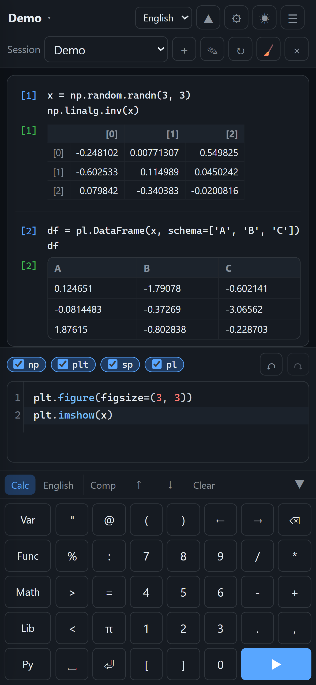

# PyCalc

[中文](README.md) | [English](README.en.md) | **[日本語](README.ja.md)**



https://ruoyu0088.github.io/pycalc

PyCalc は**単一ファイルのオフライン Python 電卓ジェネレーター**です。ビルドスクリプトが Pyodide ランタイムと選択した科学計算ライブラリをすべて 1 つの HTML にインライン化します。この HTML はダブルクリックするか `file://` で開くだけで動作し、ネットワークにアクセスせず、Jupyter/IPython 風の入出力、複数の名前付きセッション、そして再読み込みをまたいで復元される履歴と変数を備えています。

```
pycalc-app/
├─ start.bat        ← ダブルクリックで Tkinter ビルダーを起動
├─ gui.py           ← ビルダーの GUI
├─ build.py         ← コマンドラインのエントリポイント
├─ .github/workflows/deploy.yml ← GitHub Pages の自動ビルド／デプロイ
├─ pycalc_build/    ← ビルドパイプライン
├─ frontend/        ← CodeMirror のソース（成果物はコミット済み。HTML のビルドに Node は不要）
├─ tests/           ← ユニットテストとブラウザ検証
├─ cache/           ← ランタイム／wheel キャッシュ（gitignore）
└─ dist/            ← 出力 HTML（gitignore）
```

リファレンス資料（`console.html`、`inline_wasm_b64.py`、`test_indexeddb.html`）はリポジトリ外の `../reference/` に置かれており、git の管理対象外です。

---

## クイックスタート

1. `start.bat` をダブルクリックしてビルダーを起動します。
2. 「含めるライブラリ」テキストエディタで、インライン化するパッケージとエイリアスを定義し（デフォルトは numpy / matplotlib / sympy）、出力パスを選んで「ビルド」または「ビルドして開く」をクリックします。
3. 生成が完了したら HTML をダブルクリックします（または「出力を開く」をクリックします）。

初回ビルドでは Pyodide ランタイムと wheel をダウンロードするためにネットワーク接続が必要です。以降は `cache/` が再利用され、「キャッシュのみ使用（オフライン）」にチェックを入れることもできます。

### コマンドライン

```bat
:: デフォルト：Pyodide 314.0.7、すべてインライン
python build.py --libs numpy sympy matplotlib --output dist\pycalc.html

:: 旧 LTS ランタイムを指定
python build.py --libs numpy sympy --pyodide-version 0.27.8 --output dist\pycalc-0278.html

:: 標準ライブラリのみ（サイズ最小）
python build.py --libs --output dist\pycalc-min.html

:: キャッシュの準備のみ行い、HTML は生成しない
python build.py --libs numpy sympy matplotlib --fetch-only

:: 指定バージョンの lock にあるインストール可能なパッケージを一覧表示
python build.py --list-libs --pyodide-version 314.0.7

:: ビルドログの言語（zh / en / ja）
python build.py --libs numpy --lang ja --output dist\pycalc-ja.html

:: 自動インポートのエイリアスをカスタム指定（繰り返し可；np:numpy 形式も可）
python build.py --libs numpy sympy --alias np=numpy --alias sp=sympy --output dist\pycalc.html

:: パッケージのインライン化のみ（自動インポートなし／ライブラリのチェック項目なし）
python build.py --libs numpy --no-default-aliases --output dist\plain.html
```

ビルドが完了すると、最終 HTML の**正確なバイト数**、Python バージョン、依存関係のクロージャ、所要時間が出力されます。`--json` を付けると機械可読な結果が得られます（ログは stderr に出力されます）。

---

## ライブラリ定義とエイリアス

Tk ビルダーの **含めるライブラリ**（Libraries）テキストエディタは、HTML にどのパッケージを埋め込むか、そして HTML 上部にどの自動インポート用チェック項目を表示するかを直接決定します。デフォルトの内容は次のとおりです：

```text
# Packages embedded into the HTML (comma or whitespace separated).
numpy, matplotlib, sympy

# alias = import module (a colon also works)
np = numpy
plt = matplotlib.pyplot
sp = sympy
```

ルール：

- `=` / `:` を含まない行は**パッケージリスト**です。カンマまたは空白で区切ることができ、複数行に書くこともできます。
- `=` または `:` を含む行は**エイリアス定義**です：`alias = インポートするモジュール`。たとえば `pd = pandas`、`np:numpy`。
- 空行や `#` / `;` コメントは無視されます。また、読みやすさのために任意で `[packages]` / `[aliases]` のセクションを設けることもできます。
- エイリアスは有効な Python 識別子である必要があります。同じエイリアス、または同じモジュールを重複して定義することはできません。
- パッケージがどのモジュールに対応するかは Pyodide lock の `imports` メタデータから推測されるため、`plt = matplotlib.pyplot` や `sk = sklearn`（パッケージは scikit-learn）のようなサブモジュール／名前の異なるモジュールも解決できます。
- エイリアスが指すモジュールが選択済みのパッケージで提供されていない場合、ビルドは明確にエラーを出し、そのモジュールを提供するパッケージを追加するよう促します。
- **1 つのエイリアスが 1 つの HTML チェック項目に対応します**。パッケージだけを書いてエイリアスを書かない場合、そのパッケージはインライン化されますが、自動インポートのチェック項目は作成されません。
- チェック項目の動作：`np = numpy` にチェックを入れると、HTML は自動的に `import numpy as np` を実行します。`plt = matplotlib.pyplot` にチェックを入れると自動的に `import matplotlib.pyplot as plt` を実行します。`pd = pandas` も同様です。

ユーザー設定の例（pandas を含む）：

```text
numpy, matplotlib, sympy, pandas

np = numpy
plt = matplotlib.pyplot
sp = sympy
pd = pandas
```

GUI のすべての設定（このライブラリ定義を含む）は `gui_settings.json` に保存され、次回起動時に自動的に復元されます。旧バージョンで `libs` リストのみを保存していた設定は、自動的に新しいテキスト形式へ移行されます。

### リモート CSV / HTTP

すべてのビルドは `pyodide-http` を**選択不可の必須パッケージ**として自動的に内包し、Python 起動時に `pyodide_http.patch_all()` を実行します。これにより Polars がブラウザ経由で URL を読めます：

```python
import polars as pl
df = pl.read_csv("https://example.com/data.csv")
```

制限：

- リモートサーバーは `Access-Control-Allow-Origin: *` などの CORS ヘッダーを返す必要があります。ブラウザの同一オリジンポリシーを回避するものではありません。
- レスポンス全体をメモリに読み込んでから Polars に渡すため、巨大な CSV は多くのメモリを使います。
- このパッチは Python の `urllib`／`requests` 向けです。現在の Pyodide ビルドでは Polars の URL 読み込みが `urllib.request.urlopen` を通るため有効です。

### 純 Python パッケージ：Plotly の例

Pyodide 公式 lock にない純 Python パッケージは、ビルド時に PyPI から `*-none-any.whl` を取得し、wheel と依存関係をインライン化して、埋め込まれた lock に合成エントリを追加します。Emscripten ビルドは不要です。

```powershell
python build.py --libs numpy sympy matplotlib polars plotly `
  --alias np=numpy --alias plt=matplotlib.pyplot --alias sp=sympy `
  --alias pl=polars --alias px=plotly.express --output dist\pycalc.html
```

ページで `px` をチェックしてから：

```python
import pandas as pd
df = pd.DataFrame({"x": [1, 2, 3], "y": [1, 4, 9]})
px.line(df, x="x", y="y", title="Plotly")
```

最後の式が Plotly の `Figure` を返すと、wheel に同梱された `plotly.min.js` でインタラクティブなグラフとして描画され、テキスト表現の代わりになります。グラフはセッションと一緒に保存され、再読み込み後も復元されます。`fig` に代入する場合は最後の行に `fig` を書いてください。`fig.show()` は値を返さないため PyCalc はグラフを取得できません。ビルドサイズは約 82 MB です。純 Python の wheel のみ対応し、ネイティブ拡張を含むパッケージは Pyodide 公式ビルドが必要です。

---

## GitHub Pages の自動デプロイ

リポジトリにはすでに [`.github/workflows/deploy.yml`](.github/workflows/deploy.yml) が含まれています。**リポジトリのルートは `build.py` を含む `pycalc-app/` であるべきです**（親ディレクトリの `reference/` や `agent.md` を一緒にリポジトリのルートにしないでください）。プロジェクトを GitHub にプッシュすれば、自動でビルド・公開されます：

1. デフォルトブランチの `main` または `master` にプッシュします（Actions ページから `Build and deploy PyCalc` を手動で実行することもできます）。
2. 一度だけ、リポジトリの **Settings → Pages → Build and deployment** を開き、**Source** を **GitHub Actions** に設定します。GitHub の API では PAT を使って Pages を自動的に有効化できますが、デフォルトの `GITHUB_TOKEN` では「初回の有効化」を行えないため、ここだけは手動で 1 回クリックする必要があります。以降は push のたびに完全自動で公開されます。初回もクリックなしにしたい場合は、Pages への書き込み権限を持つ PAT を作成して `PAGES_TOKEN` として保存し、`configure-pages` ステップに `token: ${{ secrets.PAGES_TOKEN }}` と `enablement: true` を追加してください。
3. workflow は次のことを行います：
   - ユニットテストを実行します（ディスプレイのない環境では Tk のテストは自動的にスキップされます）。
   - Pyodide ランタイムと wheel をダウンロード、またはキャッシュから再利用します。
   - フルセットの HTML をビルドします。
   - `_site/index.html` を出力します。
   - `actions/deploy-pages` で公開します。
4. 公開が完了すると、Actions の `deploy` ジョブに URL が表示されます。形式は次のとおりです：

   `https://<ユーザー名>.github.io/<リポジトリ名>/`

デフォルトのビルド設定は workflow 冒頭の `env` にあります：

```yaml
env:
  PYCALC_VERSION: "314.0.7"
  PYCALC_LIBS: "numpy sympy matplotlib"
```

インライン化するライブラリや Pyodide のバージョンを変えたい場合は、ここを変更するだけです。デフォルトでは CLI の通常のエイリアス（`np` / `plt` / `sp` / `pd`）が使われます。Pages ビルドでもカスタムエイリアスが必要な場合は、ワークフローの `python build.py` コマンドに `--alias` 引数を追加してください（Tk の `gui_settings.json` はローカルでのみ使われ、Actions に自動同期されることはありません）。初回実行時は CDN からランタイムと wheel をダウンロードする必要があり、以降は `cache/` が再利用されます。HTML は約 34 MB で、GitHub Pages の容量制限内です。

注意：Pages サイトは独立した `https://` オリジンであるため、その IndexedDB セッションはローカルで `file://` から開いた HTML と**共有されません**。これはブラウザの同一オリジンポリシーによるものです。

---

## PWA / スマートフォンへのインストール

ビルド時に、HTML の隣に 4 つの PWA 付属ファイルが生成されます：

```text
dist/
├─ pycalc.html
├─ manifest.json
├─ sw.js
├─ icon-192.png
└─ icon-512.png
```

`pycalc.html` 自体は依然として完全に自己完結した単一ファイルです。PWA ファイルはインストールとオフラインキャッシュのための追加の兄弟ファイルにすぎません。Service Worker がキャッシュするのはエントリ HTML、manifest、アイコンのみです。Pyodide/NumPy/Matplotlib などのランタイムやインライン Worker はすべて HTML の内部にあるため、追加のキャッシュは不要です。

`manifest.json` は明るい起動背景 `#f6f7f9` とダークな `theme_color: #20252e` を使用します。manifest は静的であり、システムのテーマに追従できないためです。明るい背景はデフォルトの明るい UI に一致し、ダークなテーマ色はトップバー／ステータスバーに一致します。ダークな起動画面にしたい場合は、両方を `#0d1117` に変更してください。

### デスクトップでの確認

1. `dist/` で `python -m http.server 8000` を実行し、`http://localhost:8000/pycalc.html` を開きます。
2. Chrome/Edge の DevTools → **Application → Service Workers** を開き、`sw.js` が **activated** になっていることを確認します。
3. **Application → Cache Storage** に `pycalc-<html-hash>` が現れ、エントリページ、`manifest.json`、2 つのアイコンが含まれているはずです。
4. **Network** パネルで **Offline** にチェックを入れて再読み込みすると、ページが完全に読み込まれ、`1+1` を実行できるはずです。

`http://localhost` / `127.0.0.1` はブラウザによって安全なコンテキストと見なされるため、ローカルでも Service Worker を利用できます。それ以外の通常の `http://` ページや `file://` ページでは登録されません。

### Android Chrome

HTTPS でサイトを開きます。たとえば：

```text
https://ruoyu0088.github.io/pycalc/
```

メニュー → **ホーム画面に追加** を選び、ホーム画面のアイコンから開くと standalone（アドレスバーなし）になるはずです。初回にネットワークへ接続すると Service Worker がエントリをキャッシュし、その後はオフラインでも開いて実行できます。

### iOS Safari

- `file://` では IndexedDB がサポートされず、セッションを保存できません。
- `https://` から開いた場合は「ホーム画面に追加」が可能で、Service Worker によるオフラインキャッシュもサポートされます。
- iOS の ITP により、長期間アクセスしないとサイトのストレージが消去され、IndexedDB／キャッシュが失われることがあります。これはシステムの制限であり、フロントエンド側では回避できません。

### アップデートと制約

- `sw.js` のキャッシュバージョン番号は、最終 HTML の SHA256 の先頭 8 桁に由来します。**HTML の内容が変わると**キャッシュ名が変わり、ユーザーが次に開いたときに新しいバージョンが取得されます。
- 同じ内容で再ビルドしても `sw.js` は変わりません。これは、デプロイのたびにユーザーが HTML 全体を再ダウンロードするのを避けるためです。
- アップデートは通常 2 回の再読み込みが必要です。1 回目で新しい Service Worker を取得し、2 回目でページが新しいキャッシュから提供されます。
- `skipWaiting()` + `clients.claim()` は有効になっていますが、追加の「更新通知」UI はありません。
- `file://` では manifest はブラウザに無視され、SW の登録もプロトコル判定でスキップされます。HTML の基本機能には影響せず、インストール／オフラインができないだけです。
- `manifest.json` の `start_url` は `"./"` に固定されています（Pages 上では `index.html` になります）。ローカルで `pycalc.html` を使って HTTP 検証する場合、SW は `pycalc.html` を個別にキャッシュするためオフラインでの再読み込みは正常に動作します。しかしローカルで「インストール」した際の起動ページはディレクトリを指すため、正式なインストール／ホーム画面のテストには Pages 上の `https://.../pycalc/` URL を使用してください。
- Service Worker のキャッシュと IndexedDB は、ストレージ逼迫時にブラウザによって消去される可能性があります。登録成功後に `navigator.storage.persist()` を静かに要求して保持される可能性を高めていますが、iOS やストレージ消去のシナリオで永久に保持されることを保証するものではありません。
- 現在の Pages ビルドは pandas/polars を含み、HTML は約 **64 MB** です。初回のインストール／オフラインキャッシュは基本バージョンより重くなります。
- ローカルの `file://` と Pages の `https://` は異なるオリジンであるため、両者のセッションは共有されません。

---

## 画面の機能

- **3 言語 UI**：中国語 / English / 日本語。HTML はトップバーで、Tk ビルダーは右上で切り替えます。言語設定は記憶され、初回はブラウザ／システムの言語に従います。
- **連続した 1 つの出力ブロック**：入力・出力ごとに独立したカードを生成することはなくなり、「成功 / 時間」のヘッダーバーもありません。入力と出力は 1 つのスクロール可能なパネルに順番に並びます。
- **番号をクリックすると挿入**：入力と出力の前には `[1]`、`[2]` のような番号だけが表示されます。番号をクリックすると、対応するコードまたは出力テキストが現在のエディタのカーソル位置に挿入され、入力欄はクリアされません。画像だけでテキストがない出力の場合は、挿入できるテキストがない旨が通知されます。
- **`ans` は直前の有効な結果を保持**：実行のたびに、最後の式の結果が `None` でなければ、そのオブジェクトが `ans` に保存されます。`print(...)`、単なる代入、明示的な `None`、例外は直前の `ans` を上書きしません。`ans` は変数テーブルに表示され、セッションスナップショットとともに保存／復元されます。
- **実行後に入力欄をクリア**。`↑` / `↓` で過去の入力履歴を切り替え、最新の項目に戻ると未送信の下書きが復元されます。
- **サイドバーの幅を調整可能**：サイドバーとメイン領域の間の区切り線をドラッグして調整できます。幅は記憶されます。狭い画面ではサイドバーがドロワーになり、区切り線は自動的に非表示になります。
- **IPython 風の属性補完**：`x.`、`np.`、`np.linalg.` と入力すると、そのオブジェクトのメンバー／メソッド／モジュール関数が一覧表示され、関数項目にはシグネチャが付きます。`arr.re` のようなプレフィックスを入力すると絞り込みが続きます。補完は現在のセッションで**実行済みのオブジェクト**の実際の型を優先して使用します。変数がまだ実行されていない場合でも、エディタ内の代入／型注釈から静的に推論します。たとえば `arr = np.linspace(1, 2)` の後に `arr.` と入力しても `numpy.ndarray` として認識され、下部に `arr : numpy.ndarray` と表示されます。プライベートメンバーはデフォルトで非表示で、`_` を入力すると展開されます。トップレベルの変数／関数名は引き続き補完できますが、`if` / `for` などのキーワードは補完されなくなりました。
- **表示設定**：トップバーの歯車ボタンでダイアログを開き、SymPy 式（テキスト / 数式 / すべて数式）、NumPy 出力（デフォルト / 整形 / テーブル）、浮動小数点の精度（自動または 6/8/10/12/15 桁の有効数字）、DataFrame 出力（テキスト / テーブル）、「グラフがあるとき最後の式を隠す」を設定できます。NumPy テーブルは 1 次元配列をヘッダーなしの 1 行で表示し（列数の上限を超えると Pretty にフォールバック）、小さな 2 次元配列の表と 3 次元配列のタブ表示にも対応します。タブ数・行数・列数を制限できます。DataFrame は行数・列数を制限でき、省略された中央の列は `…` になります。DataFrame の行数は以降に生成されるテーブルにのみ影響し、それ以外の設定は既存の履歴を即座に再描画します。浮動小数点の結果は数値ツリーを保持するため、履歴の精度を何度でも切り替えられます。DataFrame テーブルと NumPy テーブルの数値セルも同じ精度で表示されます。数値・テーブル・コンテナ数式のデータを持たない古い履歴はテキストにフォールバックします。
- **履歴の取り消し／復元**：ライブラリバーの右側に Undo / Redo があり、最後の入力の履歴レコードだけを削除または復元します。現在の Python 変数、`ans`、関数は変更しません。入力ミスの項目を履歴から消すのに適しています。番号は再利用されます。
- **関数呼び出しのヒント**：`f(`、`np.linspace(`、`arr.reshape(` の中では、カーソル付近にシグネチャが表示されます。`Ctrl+Space` で手動で補完を呼び出せます。
- **括弧／引用符の自動ペアリング**：`(`、`[`、`{`、`'`、`"` を入力すると右側が自動補完されます。テキストを選択してから括弧／引用符を入力すると、選択範囲が囲まれます。
- **選択テキストの高コントラスト**：エディタの選択範囲は明るい／暗いテーマのどちらでもはっきりした背景色になり、通常のテキストと混ざりません。
- 属性補完はリアルタイムの名前空間を優先します。まだ実行されていない代入については、一般的な numpy/sympy/matplotlib のコンストラクタや型注釈から静的推論を行います。その他の複雑な式は、先に実行してから補完することをおすすめします。
- **実行キーを選択可能**：`Ctrl/Cmd+Enter` または `Enter`。`Enter` を選ぶと、Python がコードを「完全」と判断した場合にのみ実行します（`def`/`if`/閉じていない括弧、構文エラーなどは改行のままになります）。`Shift+Enter` は常に改行します。IME の変換中には誤って実行されません。
- **タッチデバイス向けの簡略化**：`pointer: coarse` かつ仮想キーボードの生成に成功した場合、実行キーの選択、実行ボタン、下部のヒントバーを非表示にします。実行の入口はキーボードの `=` キーに移動します。デスクトップモードはまったく変わりません。
- **起動シーケンス**：エディタと履歴が先に表示され、右上の固定フローティングレイヤーに `Python 読み込み中… / ライブラリ展開中… / 初期化中… / セッション復元中…` が表示されます。トップバーのレイアウトは占有しません。ランタイムが準備できるまで、実行、セッションの切り替え、拡張ライブラリのチェックは無効になります。Python は Web Worker 内で起動・実行されるため、読み込み中もメインスレッドで入力や履歴のスクロールが可能です。Matplotlib は `plt` にチェックを入れたとき、またはコードが実際に `import` したときにのみ読み込まれ、通常の計算で `matplotlib.pyplot` が読み込まれることはなくなりました。
- **ライト／ダークテーマ**：CSS、CodeMirror のシンタックスハイライト、Matplotlib のデフォルトスタイルがまとめて切り替わります。初回はシステムの `prefers-color-scheme` に従い、以降は選択が記憶されます。Matplotlib はテーマ切り替え後に生成されたグラフにのみ影響し、過去の PNG は再描画されません。
- **拡張ライブラリのチェックボックス**：入力欄の上に、**ビルド時のライブラリ定義**にある各エイリアスが表示されます。たとえば `numpy (np)`、`matplotlib.pyplot (plt)`、`sympy (sp)`、`pandas (pd)`。チェックを入れると自動的にインポートされ、`import` を書く必要はありません。新しいセッションでは Math のみがデフォルトで読み込まれ、拡張ライブラリはチェックが必要です。選択状態はセッションに保存され、セッションを切り替えると復元されます。
- **Math は常に読み込まれる**：`sin, cos, tan, sqrt, exp, log, log10, factorial, pi, e, inf, nan` などの名前が通常の電卓のようにそのまま使えます。Math は拡張ライブラリの一覧には表示されず、変数テーブルにも書き込まれません。`range` は関数ドロワーに移動しました。
- **関数ドロワー**：`keyboard_layout.py` の `drawers.functions.items` で組み込み関数を手動で管理できます（現在は `print, range, enumerate, len, int, float, str, list, dict, set, tuple, sum, min, max, sorted, zip, map, filter`）。これらの固定項目が先頭に並び、セッション中にユーザーが定義した関数が自動的に後ろへ追加されます。
- **変数ドロワー**：`drawers.variables.items` にはデフォルトで `x, y, z, a, b, c, i, j, k` が手動で登録され、ユーザー変数より前に並びます。同名のユーザー変数は重複表示されません。
- **左サイドバーの 2 つのテーブル**：現在のセッションのユーザー変数（名前 / 型 / 値）とユーザー関数（名前 / 引数）。pandas / polars の `DataFrame` 値は `shape` と先頭 8 列の列名のみを表示し、完全なテーブルは表示しません。実行のたび、セッションの切り替え時、拡張ライブラリの変更後に更新されます。自動インポートされた名前と関数はテーブルに表示されません。

---

## スマートフォンの仮想キーボード

`pointer: coarse` のデバイスでは、`#app` の下部にスクリーンキーボードを flex レイアウトの一部として生成します（fixed のオーバーレイではありません）。デスクトップブラウザではキーボードの DOM は生成されず、`inputmode` も変更されません。

### 2 つの入力タブ + クリアボタン

- **計算**：左側に 5 つの縦並びボタン（変数 / 関数 / 数学 / ライブラリ / Python）、右側に 6×5 の数字／記号キーパッド。数値キー、`π`、括弧、スペース、改行、実行キーはここにあります。
- **英語**：英字状態は 5 行で、`⇧` は次の 1 文字だけを大文字にします。`123` で数字状態に切り替わり、`ABC` で戻ります。数字状態には記号と `スペース / ← / → / 入力` が含まれます。
- **コンパクトなタブ行**：計算 / 英語 / 補完 / クリア / 折りたたみボタンは、より小さな間隔と padding を使用します。`[1]` ボタンは履歴の `[n]` 実行番号を表示／非表示にします。非表示時は入力に青い細線、出力に緑の細線を付けて区別し、内容は全幅を使えます。設定はグローバルに保存されます。
- **カーソル矢印**：タブ行の `↑` / `↓` は、通常の位置ではカーソルを上下に移動し、先頭行／最終行にあるときはそれぞれ前／次の履歴入力に切り替わります。物理キーボードの ArrowUp/ArrowDown と同じ動作です。
- **クリア**：英語タブの後ろにあり、エディタの内容だけをクリアします。現在のタブ、履歴、変数は変更しません。
- **折りたたみ／展開**：タブ行の右端にある `⌄` / `⌃` でキーボードパネルの表示を切り替えます。折りたたむとタブ行だけが残り、履歴領域が自動的に高くなります。もう一度クリックするか、計算／英語タブをタップするとキーボードがスライドして表示されます。
- **Enter で自動インデント**：`⏎` は CodeMirror の `insertNewlineAndIndent` を使用するため、`for i in range(10):` の後に Enter を押すと次の行に移り、4 つのスペースでインデントされます。
- **Session バーの折りたたみ**：スマートフォンのトップバーに `⌃` / `⌄` ボタンが追加され、セッションバーを非表示／表示できます。非表示にすると履歴領域も同様に高くなり、設定は保存されます。

左上の 4 つのボタンをタップすると、**画面の上部**からドロワーがスライドダウンします。変数／関数／ライブラリは開いた瞬間にリアルタイムで読み取られ、実行後に追加された `f` や変数はすぐに表示されます。関数項目には自動的に `(` が補われます。

### ライブラリのクイック入力タブ

ライブラリドロワーには**現在チェックされている**拡張ライブラリのタブだけが表示され、ラベルにはエイリアス（`np`、`plt`、`pd`、`pl`、`sp`、`la`）が使われ、順序はチェックした順になります。何もチェックされていない場合は「先にライブラリを選択してください」と表示されます。各タブのボタンは `keyboard_layout.py` の `library_quick` から来ており、ボタンには**英語名のみが表示され、`(` は付きません**。括弧はクリックしたときに挿入されます。

```text
?arange(    ライブラリのメンバー
?.sum(      ライブラリにもオブジェクトにもあるメンバー
.tolist(    オブジェクト専用のメンバー
.shape      オブジェクトの属性（括弧なし）
np          そのまま挿入
```

- `?arange(`：`np|` → `np.arange(`；`np.|` → `np.arange(`；行頭／演算子の後 → `np.arange(`；それ以外の位置ではそのまま `np.arange(` を挿入します。
- `?.sum(`：`np|` / `np.|` → `np.sum(`；`x|` / `x.|` / `x.y|` / `)` / `]` → `x.sum(`；行頭／演算子の後 → `np.sum(`。
- `.tolist(` / `.group_by(`：オブジェクトのコンテキストでのみ挿入されます。`np|`、`pl|`、行頭、演算子の後では「先に対象名を入力してください」と表示され、`np.tolist` や `pl.group_by` は生成されません。
- `.dtype`、`.shape`、`.T` はオブジェクトの属性としてのみ扱われます。`loc` / `iloc` は `.loc[` / `.iloc[` を使用し、表示時には `[` を付けません。
- クイックボタンのない選択済みライブラリには「このライブラリのクイック入力はありません」と表示され、タブが非表示になることはありません。

### レイアウトの唯一の情報源

キー、タブ、ビュー、ドロワーはすべて次の場所で定義されています：

```text
pycalc_build/keyboard_layout.py -> LAYOUT
```

ビルド時に `page_config["keyboard"]` を介して `CFG.keyboard` としてインライン化されます。`keyboard.js` には、ハードコードされた数学関数、キーワード、キーリストは一切含まれていません。`LAYOUT` を変更して再ビルドするだけで反映されます。`keyboard.css` / `keyboard.js` も単一ファイル HTML にインライン化されます。

### システムキーボード

- エディタの `contentDOM` には `inputmode="none"`、`autocorrect=off`、`autocapitalize=none`、`spellcheck=false`、`virtualkeyboardpolicy=manual` が設定されています。キーボードボタンの `pointerdown` はすべて `preventDefault` されるため、フォーカスがボタンに移ることはありません。
- **Android Chrome**：`inputmode=none` の下では CodeMirror のフォーカスとカーソルが維持され、システムキーボードは表示されません。それでも表示される IME がある場合、`visualViewport` の高さが急に縮んだときだけ能動的に `blur` して閉じます。
- **iOS Safari**：`inputmode=none` には依存しません（iOS は contenteditable に対して信頼できないため）。キーボード初期化時に CodeMirror を `EditorView.editable(false)` / `contenteditable=false` に切り替えますが、contentDOM に `tabindex=0` を付けてフォーカスを維持するため、CodeMirror のカーソルレイヤーは適切に再描画され続けます。エディタをタップすると `posAtCoords` で選択位置を設定し、入力はすべてカスタムキーボードから行われ、システムキーボードには編集可能なターゲットがありません。
- iOS の `.cm-cursor` は `mobile-keyboard-ios` CSS によって表示され、CodeMirror の位置に合わせて点滅します。これは追加で重ねた偽のカーソルではなく、CodeMirror 自身が再描画するカーソルレイヤーです。
- まだ実機での自動テストはできません。DevTools では `contenteditable=false`、フォーカス、カーソル位置、入力を検証できますが、システムキーボードが実際に表示されないかどうかは iPhone/Android の実機で確認する必要があります。

### 画面への適応

- `viewport-fit=cover` + `100dvh` + `env(safe-area-inset-*)`。キーボードの下部と上部のドロワーは、ノッチ／ホームインジケーターを避けます。
- キーボードの高さは約 250〜280 px です。数字／記号状態を切り替えると高さが少し変わります。
- キーボードは Service Worker / manifest に依存せず、`file://` でも同様に使用できます。

---

## バージョンとサイズ

| Pyodide | ランタイム構成 | Python | 説明 |
|---|---|---|---|
| **314.0.7**（デフォルト） | `pyodide.asm.mjs`（ESM） | 3.14.2 | 現在の最新版；numpy 2.4.6 / sympy 1.14.0 / matplotlib 3.10.8 |
| **0.27.8** | `pyodide.asm.js`（classic） | 3.12.7 | LTS 互換版；numpy 2.0.2 / sympy 1.13.3 / matplotlib 3.8.4 |

ビルダーはバージョンがどの構成に属するかを検出し、適合するアダプターを選択します。その他の 0.27.x / 0.29.x / 314.x バージョンも通常はビルドできますが、完全なブラウザ検証を行ったのは上表のみです。未知の構成では明確にエラーとなり、壊れたファイルは生成されません。

サイズの参考値（gzip 圧縮された wasm。実際の値はビルド出力に準じます）：

| 内容 | HTML の目安 |
|---|---|
| 標準ライブラリのみ | 10.1 MB（9.6 MiB） |
| + numpy + sympy | 約 20.3 MB |
| + numpy + sympy + matplotlib | **34.0 MB / 32.4 MiB**（314.0.7）；**32.7 MB / 31.1 MiB**（0.27.8） |
| + 上記 + pandas + polars（現在の Pages） | 約 **64 MB / 61 MiB** |

サイズの大半は wheel（numpy/sympy/matplotlib とその依存関係）と wasm によるものです。`file://` ではブラウザが `Accept-Encoding` を送信しないため、初回に開く際はファイル全体を解析する必要があります。最新のデスクトップ版 Chrome/Edge では通常 3〜6 秒で起動します。

---

## セッションと永続化

- トップバーの左側に**現在のセッション名**が表示され、クリックするとセッション切り替えメニューが開きます。デフォルトのセッション名は短い `Default` / `默认会话` / `デフォルト` を使用し、390px のスマートフォンでも 1 行で表示されるようにしています。
- ページ上部で**新規作成 / 名前変更 / 履歴の再描画 / クリア / 削除 / 切り替え**ができます。各セッションは独立した名前、入力履歴、実行回数、エディタの下書き、変数／関数スナップショット、そして**拡張ライブラリのチェック状態**を持ちます。
- **履歴の再描画（↻）**は現在のセッションの DOM のみを再構築し、matplotlib の PNG 用に Blob URL を作り直します。iOS Safari でセッションを切り替えた後に画像が「?」になる場合の一時的な復旧に使います。
- **現在のセッションをクリア（🧹）**は履歴、変数、関数、`ans`、エディタの内容を削除しますが、セッション名、セッション ID、拡張ライブラリのチェック状態は保持します。実行前に確認があります。
- トップバーには `cloudpickle` / `基本型のみ` バッジは表示されなくなりました。高度なスナップショットが利用できない場合でも、通知バーで機能低下を知らせます。
- データベースは `pycalc-app-v1` に固定され、固定の `appId` 検証があります：
  - HTML を**任意のディレクトリにコピー／移動**した場合や、新しい HTML を再ビルドした場合でも、**同じブラウザプロファイル**であれば同じセッションを読み書きします。
  - `TestDB_LocalFile` のような汎用的な名前でデータを書き込むことはありません。同名のデータベースで `appId` が一致しない場合は、混在を避けるため読み書きを拒否します。
- 言語、テーマ、実行キーは**グローバルな UI 設定**で、IndexedDB の `meta` に保存されます。拡張ライブラリのチェック状態は**セッションごと**に保存されます。
- データ構造は schema v2 です。v1 の古いセッションを開くと自動的に移行されます（履歴と変数は保持され、拡張ライブラリは空になります）。セッションを切り替える際は、まず `__main__` をクリアし、Math と現在の拡張ライブラリを適用し、履歴内のトップレベルの `import` を再生してから、対象のスナップショットを復元します。
- 名前空間には **cloudpickle** を使用します。実行のたびに非同期で保存され、セッションの切り替え時やページが非表示になったときにも保存されます。ビルド時のライブラリ定義によって自動インポートされたエイリアスや Math の名前はスナップショットに含まれません。
- 履歴の出力（stdout/stderr、結果、例外、matplotlib の PNG）はセッションとともに保存されます。画像は Blob として IndexedDB に保存されます。
- cloudpickle の自己診断に失敗した場合は JSON の基本型にフォールバックし、関数／クラスは復元されないことを明確に通知します。

### 知っておくべき制約

- **IndexedDB はブラウザに紐づく**：ブラウザを変える、Chrome のプロファイルを変える、PC を変える、サイトデータを消去する、のいずれでもセッションは引き継がれません。ブラウザのデータを自分でバックアップすることは可能です。マシン間の移行には別途エクスポート／インポートが必要です（現在は未実装）。
- **`file://` の同一オリジン**：Chrome/Edge はローカルファイルを同一のオリジンと見なします。理論上、他のローカル HTML も同名のデータベースを開くことができます。一意な DB 名 + appId は誤った混在を防ぐだけで、セキュリティ上の分離ではありません。機密データは、信頼できないローカル HTML と同じブラウザプロファイルに置かないでください。
- **Pyodide/Python のアップグレード**：履歴、セッション名、構造は必ず保持されます。変数／関数スナップショットは Python のメジャーバージョンをまたぐと**ベストエフォートでしか復元できません**（pickle のバイトコード互換性の制限）。失敗した場合は通知が表示され、古いスナップショットは保持されます。履歴がクリアされることはありません。
- **複数ウィンドウ**：同じセッションで複数の PyCalc ウィンドウを同時に開くと、最後に書き込んだものが勝ち、マージは行われません。一度に 1 つだけ開くことをおすすめします。
- **Matplotlib**：グラフは PNG スナップショットとして保存され、figure オブジェクト自体はセッションのシリアライズ対象外です。復元後に見えるのは画像であり、引き続き操作できる figure ではありません。テーマはその後作成されるグラフにのみ影響します。Matplotlib 同梱のフォントには中国語・日本語の字形が含まれないため、グラフ内の中国語／日本語のタイトルが□で表示されることがあります（UI のテキストには影響しません）。
- **Enter 実行キー**：完全性の判定には Python の `codeop` を使用します。閉じていないブロックや構文エラーは「不完全」として扱われ、Enter は改行のみになります。不完全なコードを強制的に実行するには Ctrl/Cmd+Enter を使ってください。
- **Web Worker**：Pyodide は独立した Worker 内で起動・実行されるため、Python の読み込みがエディタや履歴のスクロールをブロックしません。長時間の計算はその Worker を占有しますが、メイン UI は引き続きスクロール／入力できます。現時点では中断ボタンはなく、ページを再読み込みすれば終了できます。Worker のソース、Pyodide、wheel はすべて引き続き単一ファイル HTML にインライン化されています。
- **トップレベル await**：ユーザーのセルは同期的な exec/eval で実行されるため、トップレベルの `await` はサポートされません。
- **ファイルハンドル、ネットワーク接続、ジェネレーター**など pickle できないオブジェクトは復元されません。「復元できなかったもの」の通知に一覧表示されます。

---

## 動作の仕組み

1. **ビルド層**：選択したバージョンの `pyodide-lock.json` を読み込み、`depends` を再帰的に解決し、ランタイムと wheel を `cache/` にダウンロードし、wheel の SHA256 を検証します。
2. **インライン化**：wasm は gzip 圧縮してから Base64、wheel はすでに ZIP/deflate なのでそのまま Base64、`pyodide.asm.js/mjs` と `pyodide.js` はテキストとしてインライン化します。
3. **起動**：メインスレッドはエディタ／履歴／ストレージのみを担当し、インライン化されたリソースを読み込んでから Blob Worker を生成します。Worker は fetch インターセプターをインストールし、ファイル名に基づいて wasm/stdlib/lock/wheel をメモリから返してから `loadPyodide({packages})` を呼び出します。
   - HTTP/PWA：314.x は module worker を使用します。`file://` では module worker が制限されるため、classic worker に切り替え、`importScripts` の探査を隠します。
   - 314.x の `pyodide.asm.mjs` は Blob URL として動的 import し、default を `createPyodideModule` として使用します。
   - 0.27/0.29.x は classic worker を使用し、`pyodide.asm.js` がグローバルな `_createPyodideModule` を定義します。
   - Service Worker は `blob:`/`data:` リクエストを明示的にスキップし、インライン Worker をインターセプトしないようにします。
4. **セッション層**：IndexedDB に `meta / sessionIndex / sessionData` を保存します。Python 側の glue が `run / snapshot / restore / reset / replay imports / figure capture` を提供します。
5. **フロントエンド**：CodeMirror 6（Python ハイライト、行番号、明暗テーマ、Enter/Ctrl+Enter モード、履歴の上下キー）、連続した 1 つの出力ブロック、クリック可能な番号による挿入、拡張ライブラリのチェックボックス、変数／関数サイドバー、ストリーミング stdout/stderr。
6. **スマートフォンキーボード**：`keyboard_layout.py` が `CFG.keyboard` を生成し、`keyboard.js` はレンダリング／アクションのディスパッチのみを行い、`app.js` がエディタのコールバックを提供します。すべて HTML にインライン化されます。

ビルドに Node は不要です。`pycalc_build/assets/editor.bundle.js` はすでにコミットされています。エディタのソースを変更する場合にのみ、次が必要です：

```bat
cd frontend
npm install
npm run build
```

---

## 開発とテスト

```bat
:: 純粋な Python ユニットテスト（依存関係のクロージャ、エンコーディング、安定 ID など）
python -m unittest discover -s tests -p "test_*.py" -v

:: ブラウザ検証（ローカルの Chrome/Edge が必要。PYCALC_BROWSER で指定可能）
python tests\acceptance.py
```

ブラウザテストは CDP で Chrome/Edge に直接接続し、Playwright/Selenium には依存しません。Python 側では `websocket-client` のみを使用します。テストは最小／フルの HTML をビルドし、次を検証します：

- `file://` での Web Worker の起動、実行、外部ネットワークリクエストがゼロであること；実行後に入力欄がクリアされること；
- 起動進捗が固定配置のフローティングレイヤーであり、トップバーに属さず、トップバーの高さも変えないこと；
- HTTP/PWA での module worker と `file://` での classic worker の 2 つの経路；
- Math がデフォルトで利用可能（`sin(pi/2)`）で、import が不要であること；
- numpy / sympy / matplotlib と画像出力；
- 3 言語の切り替え、拡張ライブラリの自動インポートとセッションごとの復元、変数／関数テーブル；変数／関数ドロワーの手動項目がユーザー項目より前にあり重複が除かれること、`range` が Math から Func に移動していること；
- 連続した 1 つの出力ブロック、`[n]` 番号が現在のカーソルに挿入され既存の内容がクリアされないこと；
- pandas / polars の `DataFrame` 変数が shape と列名のみを表示すること；
- スマートフォンのシステムキーボードを奪わないこと：Android の `inputmode=none`、iPhone の `contenteditable=false` + focus カーソル、仮想キーボードの DOM、calc/en の 2 タブ + クリア + 折りたたみボタン、`[1]` 実行番号の表示／非表示、`(1+2)*3` → 9、`⇧` / `123` / `ABC`、言語切り替えの即時反映；
- スマートフォンのトップバーで Session バーの表示／非表示、キーボードの折りたたみ／展開後のワークスペースの高さ変化と永続化；
- ライブラリのクイックタブ：チェック済みライブラリのみ表示、エイリアスラベル、`?`/`.`/`(` を含まないボタン文字、`?` / `?.` / `.` の挿入ルール、オブジェクト専用メンバーの通知；
- 属性補完（`x.` / `np.`）、型推論（`ndarray`）、関数シグネチャのヒント、括弧／引用符の自動ペアリング、選択範囲の高コントラスト；
- 表示設定ダイアログ、SymPy のテキスト／数式／すべて数式、MathML レンダリング、NumPy の整形／テーブル表示（2 次元表、3 次元タブ、タブ・行・列の制限）、浮動小数点の精度（履歴とテーブルを含む）、DataFrame の行・列制限と中央列の省略、グラフ結果の非表示、再読み込みをまたぐ設定の復元；
- 履歴の Undo / Redo、番号の再利用、変数が取り消されないこと；現在のセッションのクリア；
- `ans` が None 以外の結果を保存し、None／エラーでは上書きされず、再読み込みをまたいで復元されること；
- ライブラリ定義テキストの解析、エイリアス／モジュールの重複排除、パッケージ→モジュールの provider 推論、GUI 設定の永続化と旧設定の移行；
- サイドバーの幅をドラッグして変更し、再読み込みをまたいで記憶されること；
- Enter / Ctrl+Enter の 2 種類の実行キー、実際のキーボードイベントでの完全性判定と `↑` による履歴ナビゲーション；
- 明暗テーマと Matplotlib が以降のグラフにのみ影響すること；
- 複数セッションの新規作成／名前変更／削除／切り替え、変数の分離、再読み込み後の復元；履歴の再描画とほうきのクリアボタン；トップバーのセッション名の 1 行表示と切り替えメニュー；
- HTML をコピーした場合、HTML を再ビルドした後でもセッションを読み取れること；
- 314.0.7 と 0.27.8 の 2 種類のランタイム構成、バージョンをまたいだ履歴の保持；
- PWA の 5 ファイル生成、manifest/SW のバージョン、ローカル HTTP での SW の activated／キャッシュ、オフラインでの再読み込み、`file://` では SW が登録されないこと；SW がインライン Worker の `blob:` リクエストをインターセプトしないこと。

---

## キャッシュとオフライン

```
cache/
├─ pyodide/<version>/     pyodide.js, pyodide.asm.*, wasm, stdlib, lock
└─ wheels/<version>/      lock 内の wheel
```

- デフォルトではキャッシュを優先します。`--refresh` で強制的に再ダウンロードします。
- `--offline` はキャッシュのみを使用し、ファイルが不足している場合は不足しているパスを一覧表示してエラーになります。
- wheel は lock の SHA256 で検証されます。検証に失敗した場合は削除して 1 回再試行します。

---

## ライセンス / 参考資料

Pyodide およびそのプリコンパイル済み wheel は、それぞれの上流ライセンス（主に MPL-2.0 / BSD / MIT）に従います。本プログラムはビルドと UI のラッパーにすぎません。Pyodide をインライン化した HTML を配布する際は、上流のライセンス情報を保持してください。
